# fire-analysis-dwhm

A spatial data warehouse for active fires in Thailand (ITCS544 term project).
NASA FIRMS fire detections (MODIS and VIIRS, 2012-01-20 to 2026-09) are cleaned,
located in the Thai district → province → country hierarchy (GADM), matched
point-in-time to protected areas (WDPA, SCD Type 2), and loaded into a star schema
in PostgreSQL/PostGIS for OLAP queries and data mining.

Example result (RQ2): **25.3% of the fire detections in Thailand fall inside a
Designated or Inscribed protected area**, plus 3.6% only inside a Proposed one
([per-year table](docs/etl_protected_area.md#rq2-share-of-thai-fires-inside-protected-areas-per-year)).

## Architecture

```mermaid
flowchart LR
    subgraph sources[Sources]
        F[NASA FIRMS<br/>MODIS, VIIRS<br/>SP + NRT]
        G[GADM 4.1<br/>boundaries]
        W[WDPA<br/>current release +<br/>monthly snapshots]
    end
    R[(data-extraction-scripts/raw/<br/>+ _manifest.jsonl)]
    subgraph stage[stage schema]
        S1[raw_firms_*<br/>as delivered]
        S2[fire_detection_clean<br/>typed, conformed, deduplicated]
        S3[fire_detection_location<br/>district / outside Thailand]
        S4[fire_detection_protected_area<br/>+ pa_bridge]
    end
    subgraph dds[dds schema: star]
        D[fact_active_fire<br/>+ 6 dimensions + bridge]
    end
    M[(meta schema<br/>event_log, dq_metrics)]
    F & G & W --> R
    R --> S1 --> S2 --> S3 --> S4 --> D
    stage -.-> M
    dds -.-> M
```



- **`stage`**: staging and transformation tables. Every step reads the previous
  one, so each can be checked and rerun on its own.
- **`dds`**: the dimensional data store (star schema), the layer to query.
- **`meta`**: run log (`event_log`), data-quality counts per step and sensor
  (`dq_metrics`), validation results.
- **`nds`**: an NDS layer exists in the 03 script but is not used; whether to use
  it is a pending team decision.

The star schema (ERD, bus matrix, grain) is described in
[docs/dds_star_schema.md](docs/dds_star_schema.md).

## Repository layout

```
data-extraction-scripts/   extraction: one script per source, lands files in raw/ (see extraction_readme.md)
controllers/               ETL jobs, one per step (table below)
init-scripts/              database DDL, run in order 01 → 10 on a fresh database
dags/airflow_dag.py        Airflow DAG (extraction is automated; see "Known limitations")
dags/ml_mining.py          clustering / anomaly detection (to be migrated to the new schema)
docs/                      one document per ETL step, with counts for the report
olap_query_results/        earlier OLAP query outputs (old schema)
docker-compose.yml         PostGIS warehouse + Airflow
```

Legacy files, superseded and due for removal in a cleanup:
`controllers/etl.py`, `controllers/etl_dim_fact.py`, `init-scripts/04_spatial_join.sql`,
the `stage.stg_*` tables (02) and `dds.dim_location_spatial` (03). Don't build on them.
The full list is in [docs/dds_star_schema.md](docs/dds_star_schema.md#superseded-legacy-objects).

## Quick start

**Prerequisites:** Docker (Docker Desktop), Python 3.12, and for extraction the
credentials described in [extraction_readme.md](extraction_readme.md) (FIRMS map
key, NASA Earthdata login, Earth Engine).

```bash
# 1. Python environment
python3 -m venv .venv && source .venv/bin/activate
pip install -r requirements.txt

# 2. Credentials for extraction (placeholders only; .env is gitignored)
cp .env.example .env                 # then fill in FIRMS_MAP_KEY, EARTHDATA_*, EE_PROJECT

# 3. Start the warehouse only (no Airflow)
docker compose up -d postgres_dwh
docker exec fire_dwh_db pg_isready -U dwh_admin -d fire_dwh
```

The database runs in the container `fire_dwh_db` on `localhost:5432`, database
`fire_dwh`, user `dwh_admin`, password `admin123` (local development values; the
jobs read `DWH_HOST`, `DWH_PORT`, `DWH_DB`, `DWH_USER`, `DWH_PASSWORD` to override
them).

### Init scripts and table changes

`init-scripts/` is mounted at `/docker-entrypoint-initdb.d`. Postgres runs these
scripts **only when the data volume is empty**, i.e. on the very first start.
On an existing database, apply a new or changed script by hand:

```bash
docker exec fire_dwh_db psql -U dwh_admin -d fire_dwh -v ON_ERROR_STOP=1 \
    -f /docker-entrypoint-initdb.d/10_dds_star_schema.sql
```

- Table changes always go in a **new** numbered file (`11_….sql`), never into an
  existing one, so existing databases can be brought up to date.
- Every script is safe to run more than once (`IF NOT EXISTS`, guarded `ALTER`s).
  Scripts 01–10 have been tested on a fresh database.
- **On a fresh database, the fact table's foreign keys and secondary indexes do not
  exist yet.** `fact_active_fire` gets its primary key from script 10, but its
  foreign keys to the six dimensions, the bridge's foreign keys and the five
  secondary indexes are created by `load_dds.py`, on its first run (it drops and
  recreates them around every bulk load).

> **Never run `docker compose down -v`.** `-v` deletes the database volume, i.e.
> the whole warehouse (13.6M fact rows plus everything in `stage`). `docker compose
> down` or `stop` without `-v` is safe.

## Running the pipeline

Steps run by hand, from the repository root, in this order. Each job runs in one
transaction and is safe to rerun: it replaces its output (no duplicates) and logs
the run in `meta.event_log`. Run times are from the current full dataset.

| # | Command | Input → output | Time | Doc |
|---|---|---|---:|---|
| 0 | `data-extraction-scripts/run_all.sh` | sources → `raw/` | hours first time | [extraction_readme.md](extraction_readme.md) |
| 1 | `python controllers/load_stage.py` | `raw/firms` → `stage.raw_firms_modis/viirs` (13,576,562 rows) | ~3 min | [etl_staging_reconciliation.md](docs/etl_staging_reconciliation.md) |
| 2 | `python controllers/clean_stage.py` | → `stage.fire_detection_clean` (13,576,064) | ~7 min | [etl_cleaning.md](docs/etl_cleaning.md) |
| 3a | `python controllers/load_reference.py` | `raw/boundaries`, `raw/firms_country` → GADM tables, `dds.dim_location` | ~30 s | [etl_location.md](docs/etl_location.md) |
| 3b | `python controllers/locate_stage.py` | → `stage.fire_detection_location` | ~9 min | [etl_location.md](docs/etl_location.md) |
| 4a | `python controllers/load_wdpa.py` | `raw/wdpa`, `raw/wdpa_historical` → `dds.dim_protected_area` (SCD2) | seconds | [etl_protected_area.md](docs/etl_protected_area.md) |
| 4b | `python controllers/locate_protected_area.py` | → `stage.fire_detection_protected_area` + bridge | ~2 min | [etl_protected_area.md](docs/etl_protected_area.md) |
| 5 | `python controllers/load_dds.py` | stage → `dds` star schema (13,576,064 fact rows) | ~4 min | [dds_star_schema.md](docs/dds_star_schema.md) |

- `load_stage.py` is incremental (a file manifest skips files already loaded);
  `--year 2020` loads one year as a test, `--full-reload` starts over.
- **Rerun everything downstream of a change.** The jobs check that their inputs are
  current (e.g. `load_dds.py` stops if the location or protected-area table is
  out of date), but they don't run the earlier steps for you.
- The two big spatial joins set `enable_parallel_hash = off`: Docker gives the
  container only 64 MB of `/dev/shm`, which a parallel hash join can exceed.

## Current state

| Stage | Rows | Doc |
|---|---:|---|
| FIRMS files staged, reconciled against the extraction inventory (0 difference) | 13,576,562 | [staging](docs/etl_staging_reconciliation.md) |
| Clean detections (498 exact duplicates removed, 127,247 flagged but kept) | 13,576,064 | [cleaning](docs/etl_cleaning.md) |
| Detections in Thailand (GADM; −0.47% against NASA's own Thailand archive) | 4,418,597 (32.5%) | [location](docs/etl_location.md) |
| Thai detections in a Designated/Inscribed protected area | 1,118,834 (25.3%) | [protected areas](docs/etl_protected_area.md) |
| `dds.fact_active_fire` (17 checks pass; reruns give identical checksums) | 13,576,064 | [star schema](docs/dds_star_schema.md) |

## Querying the warehouse

Connect with any Postgres client to `localhost:5432/fire_dwh`, or:

```bash
docker exec -it fire_dwh_db psql -U dwh_admin -d fire_dwh
```

**The fact table holds all 13.6M detections in the extraction box (5–21°N,
97–106°E), including about 9.2M outside Thailand and the flagged rows.** For
Thailand-only results, filter on `dim_location.in_thailand`, and normally also on
`dim_detection_flag.dq_pass`. Dates and times (`date_key`, `time_key`) are Thai
local time (Asia/Bangkok); the UTC time is on the fact as `acq_ts`.

```sql
-- Thai fires per province and fire year (Aug-Jul)
SELECT d.fire_year_label, l.province_name, count(*) AS fires
  FROM dds.fact_active_fire f
  JOIN dds.dim_date d           USING (date_key)
  JOIN dds.dim_location l       USING (location_key)
  JOIN dds.dim_detection_flag q USING (detection_flag_key)
 WHERE l.in_thailand AND q.dq_pass
 GROUP BY 1, 2
 ORDER BY 1, 3 DESC;

-- Fires per protected area, counting a fire in every park it lies in (bridge)
SELECT p.name_eng, p.desig_eng, count(*) AS fires
  FROM dds.bridge_fire_protected_area b
  JOIN dds.dim_protected_area p USING (protected_area_key)
 GROUP BY 1, 2
 ORDER BY 3 DESC
 LIMIT 10;
```

- `fact_active_fire.protected_area_key` is the park version valid on the fire's
  date: `0` = in Thailand but outside every protected area, `-1` = outside
  Thailand (not assessed).
- `confidence_pct` exists for MODIS only; use `dim_detection_flag.confidence_class`
  (low / nominal / high) to compare sensors.
- Detection counts pool all sensors, and one fire is often seen by several of
  them: shares are meaningful, absolute counts are detections, not distinct fires.

## Data quality and audit

- **`meta.event_log`**: one row per job run (status, rows, timings, checksums).
- **`meta.dq_metrics`**: rows before / affected / after for every rule, per run and
  sensor (cleaning rules, location classes, protected-area classes, star load).
- **`meta.location_validation`**: our Thailand counts against NASA's
  Thailand-clipped archive, per sensor and year.
- **Built-in checks**: each job verifies its result before committing (row counts
  reconciled, no orphan keys, measure totals equal to the clean table, no
  overlapping SCD2 versions, …). A failed check rolls the whole job back, so a
  table is never left half-loaded.

## Known limitations and open items

- **Airflow automates extraction only.** In `dags/airflow_dag.py`, the tasks after
  extraction (`extract_and_stage`, `load_warehouse`,
  `spatial_point_in_polygon_join`) are still placeholders that only log a row in
  `meta.etl_data_flow`; steps 1–5 above are run by hand until they are wired in.
- **The mining and OLAP scripts still use the old schema.** `dags/ml_mining.py`,
  `controllers/etl4_benchmarking.py` and `olap_query_results/` need updating; the
  mapping of every old table and column is in
  [docs/dds_star_schema.md](docs/dds_star_schema.md#migrating-the-old-olap-and-mining-scripts).
- **NDS layer:** pending team decision; `nds.*` is created but unused.
- **Legacy cleanup:** the superseded files and tables listed above.
- **Not loaded yet:** NDVI and land cover (AppEEARS) are extracted but not staged.
- **Protected-area boundaries are current-only:** every SCD2 version uses the
  latest WDPA polygon (details in
  [docs/etl_protected_area.md](docs/etl_protected_area.md#limitations)).

## Team and course

- Shiraj Pradhanang
- Shabirullah Azizi
- Benjamin Fenelon

ITCS544 Data Mining and Data Warehousing, Faculty of ICT, Mahidol University,
Term 1/2026.

## Data sources and credits

- **NASA FIRMS** active fire data: MODIS (Terra, Aqua; 1 km) and
  VIIRS 375 m (Suomi-NPP, NOAA-20, NOAA-21), Standard Processing and Near Real-Time.
  NASA Fire Information for Resource Management System, <https://firms.modaps.eosdis.nasa.gov/>.
- **WDPA**: UNEP-WCMC and IUCN, Protected Planet, World Database on Protected Areas
  (current release from Protected Planet; monthly history from Google Earth Engine
  `WCMC/WDPA`). Cite with the citation file saved next to each release
  (`raw/wdpa/CITATION_<release>.txt`).
- **GADM 4.1** administrative boundaries, <https://gadm.org>.

WDPA and GADM data may not be redistributed, and FIRMS data is large, so no raw
data is in this repository: it is downloaded by the extraction scripts into
`data-extraction-scripts/raw/` (gitignored).
