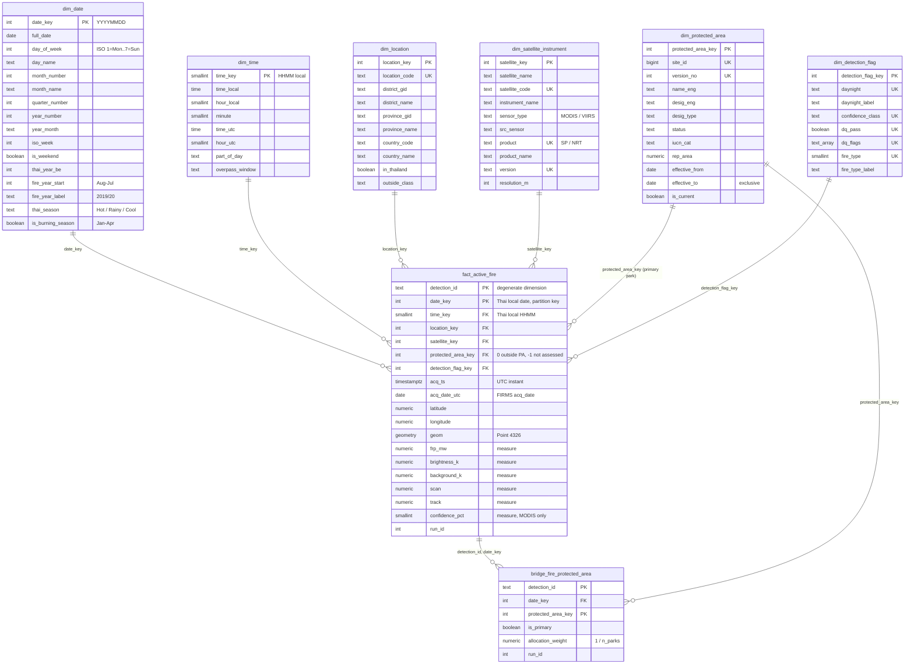

# DDS Star Schema

Fifth ETL step: the cleaned, located and protected-area-assigned detections from
items 2–4 are loaded into the dimensional data store (`dds`) as one star.

- Tables: `init-scripts/10_dds_star_schema.sql`
- Loader: `controllers/load_dds.py` (one transaction; reruns replace, never duplicate)
- Inputs: `stage.fire_detection_clean` (item 2), `stage.fire_detection_location` +
  `dds.dim_location` (item 3), `stage.fire_detection_protected_area`,
  `stage.fire_detection_pa_bridge` + `dds.dim_protected_area` (item 4)

**Result (runs 18–20, 2026-11-07): 13,576,064 fact rows and 1,363,736 bridge rows;
all 17 checks pass, and three loads give byte-identical results.** The final load
takes **231–239 s**, of which the fact itself takes 60 s (the first version took 906 s;
see *Load and checks*).

## Grain

**`dds.fact_active_fire`: one row per clean FIRMS detection**, i.e. one satellite
pixel flagged as fire at one acquisition time (`stage.fire_detection_clean`,
13,576,064 rows). Rows outside Thailand and rows with a DQ flag are **kept**; they
are identified through `dim_location.in_thailand` and `dim_detection_flag.dq_pass`,
so every analysis must decide whether to filter them (RQ queries normally use
`in_thailand AND dq_pass`).

`dds.bridge_fire_protected_area` has a finer grain: one row per (detection,
protected-area version) membership, for detections inside two or three
overlapping parks.

## ERD



`UK` marks the natural key that the loader upserts on, which keeps surrogate keys
stable across reruns. `dim_location` and `dim_protected_area` are abbreviated
(all columns: `docs/etl_location.md`, `docs/etl_protected_area.md`).

## Bus matrix

| Fact / bridge | Date | Time | Location | Satellite & instrument | Protected area | Detection flag |
|---|:-:|:-:|:-:|:-:|:-:|:-:|
| `fact_active_fire` (detection) | ✔ | ✔ | ✔ | ✔ | ✔ primary park | ✔ |
| `bridge_fire_protected_area` (detection × park) | ✔ via fact | ✔ via fact | ✔ via fact | ✔ via fact | ✔ every park | ✔ via fact |
| `ml_fire_anomalies` (detection, owned by the ML step) | via fact | via fact | via fact | via fact | via fact | via fact |

All dimensions are **conformed**: a later fact (e.g. a daily or monthly aggregate,
or a weather fact) must reuse the same `date_key`, `location_key` and
`protected_area_key`.

## Design decisions

### Thai local time for `date_key` and `time_key`

FIRMS `acq_date`/`acq_time` are UTC. Thailand is UTC+7 with no daylight saving,
and the ~01:30 night overpasses (VIIRS, Aqua) are still the previous day in UTC:
**3,193,680 (23.5%) detections** have a different local date than UTC date. For daily
counts, weekdays and season boundaries the local date is the meaningful one, so
both keys use `Asia/Bangkok`. `acq_ts` (the UTC instant) and `acq_date_utc` (FIRMS
`acq_date`) stay on the fact, so the NASA reconciliation of items 1 and 3 can be
reproduced exactly.

Exceptions to be aware of:
- The item 4 point-in-time park join used the UTC date. Park versions change at
  year or month level, so this makes no practical difference.
- The official RQ2 table is now per Thai local year, from this star schema: see
  `docs/etl_protected_area.md`, section *RQ2* (the earlier UTC-year table is kept
  below it for comparison).

### `dim_date`

2012-01-01 to 2030-12-31 (6,940 days), `date_key` = YYYYMMDD. The original columns
from 03 are kept; `day_of_week` is now ISO (1 = Monday … 7 = Sunday). Added:

| Column | Definition | Why |
|---|---|---|
| `fire_year_start`, `fire_year_label` | August–July; Aug 2019 – Jul 2020 = 2019, '2019/20' | The burning season runs December–April, across New Year; a calendar year would cut one season in two. The first (2011/12, from 2012-01-20) and the last (2026/27, to 2026-09-16) fire years are partial. |
| `thai_season` | Hot 16 Feb – 15 May · Rainy 16 May – 15 Oct · Cool 16 Oct – 15 Feb | The three seasons of Thailand with mid-month boundaries. |
| `is_burning_season` | 1 January – 30 April | Our own analytical definition, based on the data (below). |
| `thai_year_be` | year + 543 | Thai reports use the Buddhist Era. |
| `iso_week`, `iso_year`, `day_of_year`, `is_weekend`, `year_month`, `month_short` | calendar | Standard slicing. |

**Season source.** The season dates are given in the *Statistical Yearbook Thailand
2007* of the National Statistical Office, meteorology chapter, whose data is
"derived from the Meteorological Department": "Hot season, it lasts from mid -
February to mid - May", "Rainy season … from mid - May to mid - October", "Cool
season … from mid - October to mid - February"
(<https://nso.go.th/public/e-book/Statistical-Yearbook/SYB-2550/files/assets/basic-html/page686.html>,
opened 2026-11-07). "Mid-month" is taken as the 16th. The Thai Meteorological
Department's own climate page (<https://www.tmd.go.th/en/info/climate-of-thailand>)
returned HTTP 500 when opened: **to verify**. TMD declares the actual start of the
rainy season each year (e.g. 15 May or 20 May), so these are fixed climatological
boundaries, not the declared onset.

**Burning-season definition.** Share of in-Thailand detections per month,
2012-01-20 to 2026-09-16:

| Jan | Feb | Mar | Apr | May | Jun | Jul | Aug | Sep | Oct | Nov | Dec |
|---:|---:|---:|---:|---:|---:|---:|---:|---:|---:|---:|---:|
| 10.3 | 21.5 | 35.1 | 21.8 | 3.3 | 0.4 | 0.2 | 0.4 | 0.3 | 0.4 | 1.3 | 4.9 |

January–April holds **88.7%** of Thai fires. The flag is our data-based definition.
That it matches the Pollution Control Department's northern haze/burning-control
period is **to verify** (no PCD source was opened).

### `dim_time` (minute grain) instead of `acq_time` on the fact

1,440 rows, `time_key` = HHMM in Thai local time, with hour, minute, the UTC
equivalent, `part_of_day` (Night 00–05, Morning 06–11, Afternoon 12–17, Evening
18–23) and `overpass_window`. Minute is FIRMS' own resolution (868 distinct minutes
occur). A dimension costs 1,440 rows and lets BI tools slice by hour or part of day
without parsing text; the exact instant stays on the fact as `acq_ts`.

Overpass windows, from the local hour of every detection:

| Window (local) | Satellites |
|---|---|
| Night 00–04 (~01:30) | VIIRS (S-NPP, NOAA-20, NOAA-21), Aqua |
| Morning 08–11 (~10:30) | Terra |
| Afternoon 12–16 (~13:30) | VIIRS, Aqua |
| Evening 20–23 (~22:30) | Terra |

Every detection falls in one of the four windows. Day/night is **not** derived from
the clock: FIRMS `daynight` comes from the solar zenith angle at the pixel, so it
is kept as delivered, in `dim_detection_flag`.

### `dim_satellite_instrument`

One row per satellite × instrument × product × version (natural key
`satellite_code, product, version`): 11 rows. Product (SP/NRT) and version stay
here, not in the junk dimension, because they describe the data source and depend
on satellite and product; in a junk dimension they would be separated from the
satellite they belong to. `sensor_type` keeps its 03 meaning (MODIS / VIIRS);
`satellite_name` now holds the full name (Aqua, Terra, Suomi-NPP, NOAA-20,
NOAA-21) and `satellite_code` the FIRMS code (N, N20, N21, …).

### `dim_detection_flag` (junk dimension)

`daynight`, `confidence_class`, `dq_pass`/`dq_flags` and `fire_type` are
low-cardinality flags about the detection, unrelated to each other and to the
satellite. As a junk dimension they cost one integer key on the fact instead of
four text columns on 13.5M rows: 24 combinations occur. `dq_flags` follows
from `fire_type` in our data (`type_static_land`, `type_offshore`), so it adds no
combinations. `confidence_pct` stays on the fact as a measure (0–100, MODIS only;
VIIRS has only the class).

### `fact_active_fire` recreated, not altered

The 03 table was empty but could not be kept:
- Postgres cannot turn a plain table into a partitioned one; partitioning needs a
  new table.
- Its foreign key pointed at `dim_location_spatial` (one row per point), which is
  superseded by the district-grain `dim_location`.
- Its columns did not match the conformed measures (`frp`, `channel_temp_kelvin`,
  `confidence_score`, `acq_time` VARCHAR, `daynight`).

10 drops it only while it is still the plain table from 03, and refuses if it holds
rows.

**Partitioning:** RANGE on `date_key`, one partition per year 2012–2030 plus a
DEFAULT partition that must stay empty (checked). Year filters only scan their
partition, and a year can be reloaded or archived on its own.

**Primary key `(detection_id, date_key)` and no `fire_key`:** Postgres requires the
partition key in a partitioned table's primary key. The old `fire_key` BIGSERIAL
would get new numbers on every truncate-and-reload, so a rerun could not give
identical results; `detection_id` (the md5 detection key from item 2) is already a
stable unique id and serves as the degenerate dimension.

**Keys and indexes:** foreign keys to all six dimensions, so the database itself
guarantees no orphan keys. The loader drops the foreign keys and indexes before the
bulk insert and recreates them afterwards, which validates every key once instead
of row by row. Indexes: BRIN on `date_key` (rows are loaded in date order), B-tree
on `location_key`, `protected_area_key`, `satellite_key`, GIST on `geom`.

Consequence of the foreign keys: if a later `load_wdpa.py` run would delete a
protected-area version the fact still uses, it fails loudly instead of leaving
orphans. Rerun order after an upstream change:
`clean_stage → locate_stage → load_wdpa → locate_protected_area → load_dds`.

### `bridge_fire_protected_area`

A copy of the item 4 bridge (`stage.fire_detection_pa_bridge`) with `date_key`
added, so it can reference the fact's primary key. `is_primary` marks the park
chosen for the fact row (rule from item 4: designated before proposed, national
before international, smallest area, lowest site_id). `allocation_weight` is
1 / number of parks: summing it instead of counting rows splits a fire between its
overlapping parks without double counting.

- Count fires per park (each park gets its full count): `count(*)` over the bridge.
- Total fires across parks without double counting: the fact, or
  `sum(allocation_weight)` over the bridge.

## Load and checks

### Timings (run 19; run 20 within 8 s)

| Step | Seconds |
|---|---:|
| Upsert `dim_date`, `dim_time` | 0.1 |
| Upsert `dim_satellite_instrument`, `dim_detection_flag` (DISTINCT over 13.6M clean rows) | 16.8 |
| `ANALYZE` dimensions | 0.1 |
| Drop FKs/indexes, `TRUNCATE` fact + bridge | 1.1 |
| **Fact build: all surrogate keys, parallel `CREATE UNLOGGED TABLE AS`** | **29.7** |
| **Fact insert into the year partitions, in date order** | **30.4** |
| Primary key + 5 indexes + `ANALYZE` | 68.3 |
| Bridge insert | 17.1 |
| Foreign keys (validates every key) | 18.0 |
| Checks, checksums, metrics (remainder) | ~49 |
| **Total** | **231** |

**What made the first version slow (run 18: fact insert 740 s, total 906 s).**
`INSERT … SELECT` never runs in parallel, and the two small new dimensions had no
statistics yet, so the planner estimated **458 rows instead of 13.6M** and chose
one index lookup per row for the location and protected-area joins. Two changes:

1. `ANALYZE` the dimensions right after their upsert. The estimate is still low
   (13,885 rows) because Postgres treats the 3-column satellite join and the
   5-column flag join as independent conditions, but the plan becomes parallel.
2. Two phases: resolve all keys in a parallel `CREATE UNLOGGED TABLE AS`
   (29.7 s), then insert into the partitioned fact with a plain ordered
   `INSERT … SELECT` (30.4 s). The same trick as item 4.

`enable_parallel_hash = off` is set from the start (the 64 MB `/dev/shm` limit of
item 4); no shared-memory error occurred. Run 19 was compared against run 18,
which used the old serial path: identical checksums, so the faster path loads
exactly the same rows.

### Checks (every run; any failure rolls the whole load back)

| Check | Result |
|---|---:|
| Fact rows = `stage.fire_detection_clean` rows (13,576,064, also per sensor in `dq_metrics`) | 0 difference |
| DEFAULT partition empty | 0 rows |
| Orphan `date_key` / `time_key` / `location_key` / `satellite_key` / `protected_area_key` / `detection_flag_key` (anti-joins, on top of the FKs) | 0 / 0 / 0 / 0 / 0 / 0 |
| Bridge rows without a fact row | 0 |
| Count and sum of every measure (`frp_mw`, `brightness_k`, `background_k`, `scan`, `track`, `confidence_pct`) per sensor = clean table | 0 differing sensors |
| Fires per location = item 3 (`stage.fire_detection_location`) | 0 differing members |
| Fires per `protected_area_key` = item 4 | 0 differing keys |
| Bridge rows = item 4 bridge (1,363,736) | 0 difference |
| One `is_primary` bridge row per fact row in a park | 0 difference |
| `allocation_weight` sums to 1 per detection | 0 detections off |
| `dim_date.full_date + dim_time.time_local` = `acq_ts` in Asia/Bangkok | 0 rows off |
| `acq_date_utc` = UTC date of `acq_ts` | 0 rows off |

### Rerun test

The loader stores an order-independent checksum of every fact row and bridge row
(sum of 64-bit row hashes over all columns except `run_id`) and an md5 of the
dimension keys and attributes in `meta.event_log`, and compares them with the
previous successful load:

| Run | Fact checksum | Bridge checksum | Dimension md5 | vs previous |
|---|---|---|---|---|
| 18 | −5995160288199138806276 | −4063257242522810470576 | b2cc54f9…1608 | first load |
| 19 | −5995160288199138806276 | −4063257242522810470576 | b2cc54f9…1608 | IDENTICAL |
| 20 | −5995160288199138806276 | −4063257242522810470576 | b2cc54f9…1608 | IDENTICAL |

All surrogate keys are unchanged across the three runs (11 satellite keys 1–11,
24 flag keys 1–24): dimensions are upserted on their natural keys, never
truncated.

### Sizes

| Table | Rows |
|---|---:|
| `dim_date` | 6,940 |
| `dim_time` | 1,440 |
| `dim_satellite_instrument` | 11 |
| `dim_detection_flag` | 24 |
| `dim_location` | 938 |
| `dim_protected_area` | 491 |
| `fact_active_fire` (15 non-empty year partitions, 4.15 GB incl. indexes) | 13,576,064 |
| `bridge_fire_protected_area` | 1,363,736 |

Fact rows per partition (Thai local year): 2012 535,208 · 2013 642,240 ·
2014 666,648 · 2015 684,827 · 2016 758,323 · 2017 446,696 · 2018 558,525 ·
2019 1,343,269 · 2020 1,390,473 · 2021 893,446 · 2022 536,293 ·
2023 1,282,796 · 2024 1,444,194 · 2025 1,060,276 · 2026 1,332,850.
A count over one year reads only its partition (2020: 134 ms).

Detections whose Thai local date differs from the UTC date, per sensor
(`dq_metrics` step 402): VIIRS S-NPP SP 1,755,845 · NOAA-20 SP 1,079,535 ·
NOAA-21 NRT 323,323 · MODIS SP 33,893 · other NRT 1,084. Total **3,193,680**
(23.5%). MODIS is low because almost all MODIS detections are daytime, and Terra's
night pass (~22:30 local) is the same calendar day in UTC; only Aqua's ~01:30
night pass shifts.

## Superseded legacy objects

To be removed in a cleanup once the team agrees (nothing was dropped here except the
empty `fact_active_fire`):

| Object | Defined in | Superseded by | Note |
|---|---|---|---|
| `nds.*` (`nds_satellite`, `nds_instrument`, `nds_location`, `nds_protected_area`, `nds_fire_event`) | 03 | — | The NDS layer is a pending team decision; left untouched. The current pipeline loads stage → dds directly. |
| `stage.stg_*` (old staging tables) | 02 | `stage.raw_firms_*` (06), `stage.fire_detection_clean` (07) | |
| `dds.dim_location_spatial` | 03 | `dds.dim_location` (08) + lat/lon/geom on the fact | Empty; one row per point would be as large as the fact. |
| `init-scripts/04_spatial_join.sql` | 04 | `controllers/locate_protected_area.py` (item 4) | References `dim_protected_area.geom`, `idx_dds_pa_geom` and `dim_location_spatial`, which no longer exist / are superseded. |
| `dds.ml_fire_anomalies.fire_key` | 05 | `detection_id` (added by 10) | FK dropped by 10; column kept, marked deprecated. |
| `controllers/etl.py`, `controllers/etl_dim_fact.py` | — | `load_stage.py` … `load_dds.py` | Load the old `stg_*`/`nds` path. |

Already removed: `controllers/etl4_benchmarking.py` and the old `olap_query_results/*.csv`,
replaced by the five queries in `olap/` and `controllers/olap_benchmark.py`
([olap_queries.md](olap_queries.md)).

## Migrating the old mining script

`dags/ml_mining.py` was written against the 03 schema and is **not changed
here**. The old OLAP script (`etl4_benchmarking.py`) and its result CSVs have
been replaced by `olap/` and `controllers/olap_benchmark.py`
([olap_queries.md](olap_queries.md)); their entries in the "Used in" column below
are kept only as a record of what the old queries did. Every old table and column:

| Old (03 schema) | Used in | New | Note |
|---|---|---|---|
| `fact_active_fire.fire_key` | etl4 (`COUNT(f.fire_key)`), ml_mining (select, insert) | `fact_active_fire.detection_id` | `fire_key` no longer exists (see below). Count with `count(*)`. |
| `fact_active_fire.brightness_kelvin` | ml_mining, OLAP 2 (`avg_sensor_brightness`) | `fact_active_fire.brightness_k` | MODIS `brightness`, VIIRS `bright_ti4`. |
| `fact_active_fire.channel_temp_kelvin` | ml_mining | `fact_active_fire.background_k` | MODIS `bright_t31`, VIIRS `bright_ti5`. |
| `fact_active_fire.frp` | ml_mining, OLAP 2 and 4 (`avg_frp`) | `fact_active_fire.frp_mw` | |
| `fact_active_fire.confidence_score` | etl4 (≥ 80 / 50–79 / < 50), ml_mining, OLAP 2, 4, 5 | `fact_active_fire.confidence_pct` (number) or `dim_detection_flag.confidence_class` (class) | `confidence_pct` is **MODIS only** (NULL for VIIRS, which delivers only l/n/h). For all sensors use `confidence_class`: low / nominal / high, where MODIS is low 0–29, nominal 30–79, high 80–100 (item 2). The old 50/80 thresholds are not the FIRMS classes. |
| `fact_active_fire.daynight` | OLAP 4 (`daynight`, `observation_period`) | `dim_detection_flag.daynight` / `daynight_label` | Join on `detection_flag_key`. |
| `fact_active_fire.acq_time` (VARCHAR) | — | `fact_active_fire.time_key` → `dim_time` (local), or `acq_ts` (UTC instant) | |
| `fact_active_fire.date_key` | etl4, OLAP 5 | `fact_active_fire.date_key` | Same name, **now Thai local date** (see below). |
| `fact_active_fire.location_key` → `dim_location_spatial` | ml_mining, etl4 | `fact_active_fire.location_key` → `dim_location` | Different dimension: district grain. |
| `fact_active_fire.satellite_key`, `protected_area_key` | OLAP 2 | same names | `protected_area_key` is now point-in-time: 0 = in Thailand outside every park, −1 = outside Thailand (not assessed). |
| `dim_location_spatial.latitude`, `longitude` | ml_mining | `fact_active_fire.latitude`, `longitude` | On the fact; no join needed. |
| `dim_location_spatial.geom` | etl4 | `fact_active_fire.geom` | |
| `dim_location_spatial.province_name`, `district_name` | — | `dim_location.province_name`, `district_name` (+ `_th`, GIDs) | |
| `dim_date.year_number`, `quarter_number` | etl4, OLAP 5 | same | Local date. Range is now 2012–2030 (was 2020–2030). |
| `dim_date.day_of_week` | — | same name | Now ISO 1 = Monday … 7 = Sunday (was `DOW` 0 = Sunday). |
| `dim_satellite_instrument.sensor_type` | OLAP 2 | same | MODIS / VIIRS. |
| `dim_satellite_instrument.satellite_name` | OLAP 2 (values `N`, `N20`, `Aqua`, `Terra`) | `satellite_code` for the FIRMS codes; `satellite_name` is now the full name | Plus new `product` (SP/NRT) and `src_sensor`. |
| `dim_protected_area.geom` | etl4 (`ST_Within`) | `stage.wdpa_polygon.geom` (current release) | Geometry is no longer on the SCD2 dimension. |
| `dim_protected_area.is_current` | etl4 | same | Do not use it to assign fires; the fact already has the version valid on the detection date. |
| `dim_protected_area.effective_timestamp`, `expiry_timestamp` | — | `effective_from`, `effective_to` (DATE, `effective_to` exclusive) | |
| `ml_fire_anomalies.fire_key` | ml_mining (insert) | `ml_fire_anomalies.detection_id` | FK dropped; `fire_key` kept but deprecated. |

**What to change:**

- **`ml_mining.py`**: select `f.detection_id, f.brightness_k, f.background_k,
  f.frp_mw, f.confidence_pct, f.latitude, f.longitude` from `dds.fact_active_fire`
  without the location join, and insert `detection_id` into `ml_fire_anomalies`.
  `confidence_pct` is NULL for VIIRS (about 90% of rows), so the Isolation Forest
  needs either MODIS only or `confidence_class` encoded as 0/1/2. The fact has
  13.6M rows (the old tests had ~1.5M); filtering on `in_thailand AND dq_pass`
  (4.4M Thai detections) and/or a year keeps the KD-tree pass manageable.

**`fire_key` → `detection_id`.** The partitioned fact's primary key is
`(detection_id, date_key)`. `detection_id` alone is unique, stable across reruns
and identical to the id in all stage tables, so it is the link for
`ml_fire_anomalies`. Add `date_key` to a join when you want partition pruning.

**Dates are Thai local time.** `date_key`, `dim_date` and `dim_time` are
Asia/Bangkok. Night detections between 00:00 and 07:00 local carry the next
calendar day compared with the old UTC-based `date_key`. For UTC, use `acq_ts` or
`acq_date_utc`.

## Metrics

- `meta.event_log` `LOAD_DDS`: row counts, checksums and timings in `note`.
- `meta.dq_metrics` steps 401–403: fact rows per sensor against the clean table,
  detections whose local date differs from the UTC date, bridge rows.

```sql
-- Thai fires per fire year and season, designated parks only
SELECT d.fire_year_label, d.thai_season, count(*) AS fires
  FROM dds.fact_active_fire f
  JOIN dds.dim_date d            USING (date_key)
  JOIN dds.dim_location l        USING (location_key)
  JOIN dds.dim_detection_flag q  USING (detection_flag_key)
  JOIN dds.dim_protected_area p  USING (protected_area_key)
 WHERE l.in_thailand AND q.dq_pass AND p.status IN ('Designated', 'Inscribed')
 GROUP BY 1, 2 ORDER BY 1, 2;
```
